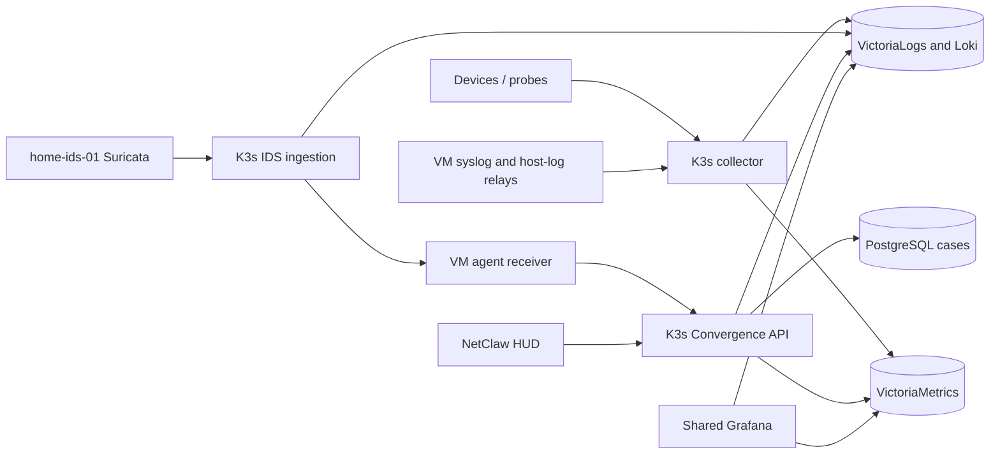

# Project Victoria stacks with Helm

`victoria-stack` is a reusable chart for independent metrics/logging stacks.
`convergence` adds the NetClaw data plane and depends on that same chart.
Each release gets its own namespace, stores, durable queues, rules and Grafana
UIDs. One existing Grafana can browse every project's data sources and dashboard
copies. Neither chart installs another Grafana or a cluster-wide operator.

The home production release is `convergence` in `netclaw-convergence`, using
`profiles/convergence-home-live.yaml`. Its metrics, logs, cases and IDS ingestion
run on K3s; the existing `observability` namespace supplies shared Grafana and
GoFlow2 capture. The VM supplies the NetClaw agent/HUD and bounded log forwarding.
See [the home cutover runbook](HOME-CUTOVER.md) for endpoints, storage, verification
and rollback. The original `convergence-home.yaml` remains a **preview-only**
profile; do not apply it to the live release.



## Home GitOps ownership

The home release is being adopted by Argo CD using the live profile followed by
`profiles/convergence-home-argocd.yaml`. After adoption, change these files through
Git; do not run `helm upgrade`, `helm rollback`, or `helm uninstall` against the
home release. The retained Helm history is recovery evidence, not an active
reconciler. Argo starts with manual synchronization and no pruning.

The Argo overlay pins privately published API/IDS images by digest and references
an externally provisioned `ghcr-pull` Secret. Application credentials, TLS keys,
and existing PVCs also remain outside Git. Upstream dependency archives are
vendored so Argo can build the local umbrella chart from a clean checkout.

`sharedGrafana.registrationMode: external` emits a Grafana bundle without the
registrar hook or cross-namespace RBAC. Shared Grafana configuration is owned by
the observability GitOps application. For new stacks sharing that Grafana, use
external mode and merge the rendered bundle into the observability configuration
in Git before syncing it. The default Helm registration mode is for Grafana
instances that are not already managed by GitOps.

## Included services

| Reusable `victoria-stack` | Additional `convergence` services |
|---|---|
| VictoriaMetrics Single, VictoriaLogs Single | PostgreSQL 16 and Convergence API |
| vmagent with persistent remote-write queue | Loki compatibility for existing LogQL queries/rules |
| vmalert and persistent Alertmanager | Blackbox and Pushgateway; optional UniFi exporter |
| OTel collector with persistent log-delivery queue | Existing syslog parsers and project dashboard copies |
| Optional registration into shared Grafana | Optional IDS ingestion, GeoIP updates, speed tests and flow-log forwarding |

The Victoria storage charts are pinned official upstream dependencies; see the
tracked `Chart.lock` files. vmagent/vmalert use the matching metrics version.
Collector/Loki compatibility versions intentionally match the existing parser and
Loki exporter; update their configuration and image pins together. Storage
retention is configurable and does not reserve sufficient capacity by itself.

## Install another Victoria stack for a new purpose

Use Helm 4 (validated with 4.3.1), kubectl, and Python with PyYAML for local checks.
Set `KUBECONFIG` explicitly to the intended cluster. For this home cluster the
working direct configuration is `/home/ubuntu/k3s-observability-stack/kubeconfig`.
`/home/ubuntu/kubectl.yaml` currently depends on an unresolved Rancher hostname.

```sh
helm repo add vm https://victoriametrics.github.io/helm-charts/
helm dependency build deploy/helm/victoria-stack
helm upgrade --install my-purpose deploy/helm/victoria-stack \
  --namespace victoria-my-purpose --create-namespace \
  -f deploy/helm/profiles/example-project.yaml --wait --timeout 10m
helm test my-purpose --namespace victoria-my-purpose --logs
```

This creates a fresh stack and adds `victoria-my-purpose/my-purpose / Metrics`
and `/ Logs` to the existing Grafana. Change retention, sizes and scrape jobs in
that purpose's values file. The same chart can be installed again under a
different release/namespace; it has no Convergence dependency or home IPs.

Internal endpoints for a release named `my-purpose`:

| Protocol | Service / path |
|---|---|
| PromQL | `my-purpose-metrics:8428/api/v1/query` |
| Prometheus remote write | `my-purpose-metrics:8428/api/v1/write` |
| LogSQL | `my-purpose-logs:9428/select/logsql/query` |
| JSON-line logs | `my-purpose-logs:9428/insert/jsonline` |
| OTLP HTTP | `my-purpose-collector:4318/v1/logs` and `/v1/metrics` |
| OTLP gRPC | `my-purpose-collector:4317` |

Use `<service>.<namespace>.svc.cluster.local` across namespaces. Telemetry services
are ClusterIP by default. Namespace separation gives independent stores and
configuration; it is not an authentication or hostile-tenant network boundary.
Release names are limited to 40 characters to leave room for component suffixes.

## Initial parallel preview (historical staging procedure)

```sh
export KUBECONFIG=/home/ubuntu/k3s-observability-stack/kubeconfig
kubectl create namespace netclaw-convergence --dry-run=client -o yaml | kubectl apply -f -
python3 deploy/helm/scripts/prepare-convergence-secret.py \
  --namespace netclaw-convergence --copy-host-ids

# Build the checked-out source and identify it by its commit.
api_build_tag=$(git rev-parse --short=8 HEAD)
docker build -t "netclaw-convergence-api:$api_build_tag" ui/convergence-api
deploy/helm/scripts/load-api-image.sh netclaw-convergence \
  k3s-worker-macmini-1 "netclaw-convergence-api:$api_build_tag"

helm dependency build deploy/helm/victoria-stack
helm dependency build deploy/helm/convergence
helm upgrade --install convergence deploy/helm/convergence \
  --namespace netclaw-convergence \
  -f deploy/helm/profiles/convergence-home.yaml \
  --set-string api.image.tag="$api_build_tag" --wait --timeout 10m
helm test convergence -n netclaw-convergence --logs
python3 deploy/helm/scripts/verify-convergence.py netclaw-convergence convergence
```

`prepare-convergence-secret.py` creates separate database/JWT/API credentials and
retains an existing Secret on later runs. `--copy-host-ids` copies only the read-only
sensor status credentials and public CA, never the sensor's ingest token or the
live receiver's write credential. Secret values never enter Helm values or release
manifests. Keep application Secrets independently managed during upgrades/rollback.

The image loader is a bootstrap alternative to a private registry. It creates a
short-lived pod on the specified node, mounting only that node's containerd socket.
The host briefly serves one image archive on an unguessable URL restricted to the
node's IP; the pod verifies SHA-256 before import. The pod and temporary endpoint
are removed on completion. This needs administrator permission for that hostPath;
regular chart workloads do not mount node sockets. For future multi-node API
scheduling, publish an immutable multi-architecture image to your own registry and
set `api.image` and scheduling values instead.

The home profile pins heavy workloads and the current AMD64 API image to the Mac
mini. Victoria storage images support the cluster's ARM64/AMD64 mix. It uses
explicit Longhorn storage classes. Existing Longhorn placement can put multiple
replicas on the Mac mini: replicated volumes here do not establish protection from
that whole machine failing. Resolve replica failure domains and capacity before
relying on this deployment for production retention or failover.

The preview:

- Federates existing `site="home"` and NetClaw metrics read-only from host
  Prometheus. It also scrapes its own Victoria/probe services.
- Accepts syslog/OTLP into its own collector, Loki and VictoriaLogs. Devices and
  IDS shipping have not been redirected or dual-written into these new stores;
  initial log verification uses explicitly synthetic canaries.
- Disables SNMP polling in the preview to avoid duplicating device collection;
  the canonical Convergence parser configuration is retained for the later cutover.
- Evaluates project rules into an Alertmanager with an empty receiver. It sends
  no duplicate notifications or model investigations to the live agent plane.
- Exposes an authenticated API at `http://192.168.13.12:30081`; HUD configuration
  continues using the Docker API. The new API deliberately has no write path to
  the existing alert receiver.

Before cutover, plan case/database backup-and-restore, metrics/log-history transfer,
collector/sensor/flow destinations, receiver wiring, capacity, source deduplication
and rollback. Read-only metric federation is a temporary preview input, not the
final independent monitoring path.

## Shared Grafana integration

The home Grafana is `observability/grafana`, available at
`https://grafana.internal.byrnbaker.me/`. The existing VictoriaLogs plugin is required
for log data sources. Generic installations can set `sharedGrafana.enabled=false`
and consume the generated service endpoints using their own Grafana workflow.

A Helm post-install/post-upgrade job merges release-specific provisioning into the
existing data-source/dashboard ConfigMaps. Names include namespace/release; UIDs
include a deterministic hash of both. Original data-source UIDs, defaults, dashboard
files and other projects remain intact. Copied Convergence dashboards point to the
new project's UIDs. Only changed provisioning triggers a brief Grafana pod restart;
unchanged upgrades are idempotent.

The registrar can read ConfigMaps only in its own namespace and patch only the two
configured Grafana ConfigMaps and named Grafana Deployment. It cannot read Secrets,
modify unrelated deployments or access node sockets. It checks the ConfigMap size
limit and retries resource-version conflicts rather than overwriting concurrent
changes. At larger dashboard counts, shard provisioning into additional ConfigMaps
or adopt a Grafana sidecar/operator before the configured bundle reaches 1 MiB.

Back up shared provisioning before the first registration. Home baseline snapshots
are kept locally under ignored `deploy/helm/private/`. If provisioning fails, inspect
`<release>-grafana-register` job logs; a retry is safe. Each ConfigMap update is
atomic, but registration across both maps is not a multi-resource transaction.

## Verification, packaging and lifecycle

```sh
python3 deploy/helm/scripts/sync-assets.py --check
helm lint deploy/helm/victoria-stack --strict
helm lint deploy/helm/convergence --strict -f deploy/helm/profiles/convergence-home.yaml
.venv/bin/python -m pytest deploy/helm/tests -q
helm test convergence -n netclaw-convergence --logs
python3 deploy/helm/scripts/verify-convergence.py netclaw-convergence convergence

mkdir -p deploy/helm/artifacts
helm package deploy/helm/victoria-stack -d deploy/helm/artifacts
helm package deploy/helm/convergence -d deploy/helm/artifacts
```

The generic Helm test writes and retrieves uniquely labelled metric/log canaries
inside the release, both directly and through OTLP. The Convergence check writes, reads and archives one clearly
synthetic case, verifies PostgreSQL/history, and reads sensor status without
running a model. For live preview metrics, query the new metrics endpoint for
`netclaw_ids_sensor_last_seen_timestamp_seconds` and compare sample freshness.

Use `helm upgrade --install` with the same versioned values file. For an upgrade
failure, use `helm rollback <release> <revision> -n <namespace>` after inspecting
status/logs. New chart versions should retain dependency locks and immutable images.
Helm 4's `--rollback-on-failure` can automate upgrade rollback; first-install failures
remain inspectable unless explicitly cleaned up.

`helm uninstall` removes the release workloads but retains StatefulSet data claims.
It also intentionally retains entries already merged into shared Grafana, so an
uninstall cannot unexpectedly delete shared UI history. Retire that project's
provisioning entries explicitly when retiring its identity. Do not delete its
namespace/PVCs as a troubleshooting shortcut. Deleting a namespace deletes those
claims and may delete the corresponding Longhorn data under its reclaim policy.

When applying the older observability manifests, preserve the merged provisioning
ConfigMaps or rerun the project Helm upgrade afterward. The project release does
not take ownership of the existing Grafana deployment or its database.

Canonical assets are copied by `scripts/sync-assets.py`; run it after changing the
source exporters/rules/dashboards. Tests detect drift. Dependency archives and
packaged artifacts are generated/ignored; chart source, locks, profiles and scripts
are tracked.

Primary references: [VictoriaMetrics chart](https://docs.victoriametrics.com/helm/victoria-metrics-single/),
[VictoriaLogs chart](https://docs.victoriametrics.com/helm/victoria-logs-single/),
[Grafana provisioning](https://grafana.com/docs/grafana/latest/administration/provisioning/).

## Original preview acceptance

The parallel release passed chart linting, seven focused tests, Kubernetes server
validation, and live Helm tests for direct metric/log and OTLP round trips. A
second temporary purpose-specific release passed the same ingestion checks;
canaries remained isolated between stores. Metric/log canaries survived restarting
both primary storage pods. The API persisted/read/archived a synthetic case and
retrieved the live IDS status. PostgreSQL startup is gated before the API initializes
its schema, and readiness checks require the case table to exist.

Shared Grafana reported all three project data sources healthy, returned fresh
`home-ids-01` metrics through its proxy, and listed five project dashboard copies.
Its original four data sources and sixteen provisioning files were preserved.
The registrar's full-flow test covers repeated provisioning without another
Grafana restart. No historical case/log migration, device reconfiguration or HUD
cutover was performed.
