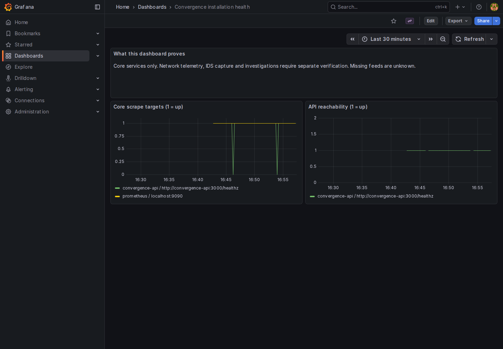

# Try Convergence with Docker

This installs six services: PostgreSQL, the Convergence API, Prometheus,
Alertmanager, blackbox exporter and Grafana. No router credentials, IDS sensor,
NetClaw runtime or model subscription are needed. Allow several minutes for the
first image download and build.

## Before you begin

Use Linux containers and a **local** Docker daemon:

- Linux: Docker Engine with the Compose v2.20+ plugin (or a newer major release).
- macOS: Docker Desktop, with the terminal and checkout on the same computer.
- Windows: run these commands inside WSL2 with Docker Desktop integration enabled
  for that distribution. Keep the checkout and bundle in the Linux home directory,
  not `/mnt/c`, so private file permissions work as intended.

See Docker's [Compose installation guide](https://docs.docker.com/compose/install/).
You also need Git and Python 3.10 or newer. The helper uses no Python packages.
Start with 4 CPU cores, 8 GiB RAM available to Docker and 20 GiB free disk as a
planning allowance, not a measured minimum. Retained data increases disk usage.
Native Windows Python and remote Docker daemons are outside this trial path.

Use a checkout containing this add-on. From its root:

```bash
python3 --version
docker version
docker compose version
python3 workspace/skills/convergence-setup/scripts/setup.py preflight
```

Docker must report a reachable server. Use a current Compose plugin;
`run --action validate` below checks the actual configuration before starting it.
The [platform record](verification.md) states what has been executed, including
where macOS, WSL2 and ARM64 still need runtime qualification.

## Prepare your private bundle

Run the following in one terminal from the checkout root. Choose a new bundle
path, a unique Compose project name and unused ports if the examples conflict.
The site is an identifier, such as `office`, `home` or `lab`.

```bash
bundle="$HOME/.local/share/convergence/trial"
helper="workspace/skills/convergence-setup/scripts/setup.py"
python3 "$helper" prepare --output "$bundle" \
  --site lab --project convergence-trial \
  --api-port 3080 --prometheus-port 9090 --alertmanager-port 9093 \
  --blackbox-port 9115 --receiver-port 8099 --grafana --grafana-port 3300
python3 "$helper" run --bundle "$bundle" --action validate
python3 "$helper" run --bundle "$bundle" --action start
```

The helper creates private configuration beneath an owner-only directory. Repeating
`prepare` with the same options preserves passwords and edits; it refuses a
different identity or an incomplete bundle. Store it outside the checkout and
back it up privately. Never paste its contents into an issue or chat.

Use `run` for lifecycle commands: it removes conflicting exported Compose settings
before reading this bundle. It also rejects remote Docker daemons, whose bind
mounts and localhost addresses would refer to a different machine.

## Verify and open Grafana

Wait about 30 seconds for initial scrapes, then:

```bash
python3 "$helper" run --bundle "$bundle" --action status
python3 workspace/skills/convergence-setup/scripts/verify.py --bundle "$bundle"
```

Every reported core check should pass, including the Grafana datasource query and
rejection of unauthenticated or wrong-site requests. An empty network feed is
expected until you add telemetry. If a check fails, use [Troubleshooting](troubleshooting.md).

Open **http://127.0.0.1:3300**. Read `access.txt` inside your private bundle locally
for the generated administrator password; username is `admin`. Open
**Dashboards → Convergence installation health**. Anonymous viewing is disabled.
Grafana is deliberately on a different port from NetClaw's frontend.



The example above uses synthetic installation checks, not real device telemetry.

To exercise case persistence explicitly:

```bash
python3 workspace/skills/convergence-setup/scripts/verify.py --bundle "$bundle" --canary
```

This writes and archives a labeled synthetic case. It does not invoke a model or
send an alert. Later verification checks that the previous canary still exists.

## Stop, resume and connect NetClaw

```bash
python3 "$helper" run --bundle "$bundle" --action stop
python3 "$helper" run --bundle "$bundle" --action start
python3 workspace/skills/convergence-setup/scripts/verify.py --bundle "$bundle"
```

Stopping keeps the project volumes and configuration. Do not delete volumes to
fix authentication or startup problems. See [operations](operations.md) for
backup, upgrades, removal and connecting `hud.env` to an existing NetClaw runtime.

This trial does not start the legacy `full` profile: that profile contains extra
collectors and platform-specific mounts. For persistent Victoria storage,
OpenTelemetry collection and reusable releases, use the [K3s guide](k3s.md).
