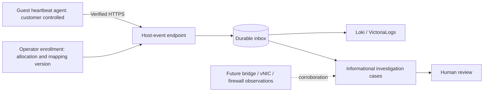

# Rental VM telemetry prototype

This code-only prototype adds guest collection health and a typed host-event input
to Convergence's existing IDS ingest service. It is for evaluating the design with
synthetic data. It has not been installed on customer VMs, qualified against the
live K3s stack, or connected to a hypervisor inventory.

The supplied agent sends **heartbeats about its own collection and spool health**.
It does not yet detect scans, inspect sockets, collect packet contents, or identify
compromised VMs. A connection-observation contract supports synthetic fixtures and
future narrowly scoped collectors. No connection collector ships in this milestone.

## How evidence reaches Convergence



Authenticated guest data is still a guest claim. A customer with root can stop the
agent, forge its reports, change its clock or suppress observations. Missing
heartbeats mean visibility is lost; they do not prove compromise. Network abuse
decisions need observations outside the guest and reliable attribution.

The operator-only host-status API is separate from the existing IDS status API.
This prototype does not add a tenant dashboard or tenant-facing query service.
The existing shared Grafana can query host logs after deployment and datasource
configuration; a dedicated tenant-facing rental-VM dashboard is not included.

The authorized operator-view follow-up exposes VM heartbeat health in the existing
Convergence Security view and installed API dashboard. The Convergence API uses its
existing status credential and authorized site, returning only display fields.
Operators see the reported state, heartbeat observation time, receiver contact,
queue/drop counters and expiry. Tenant/allocation/mapping bindings and credentials
remain server-side. Missing or stale telemetry indicates lost visibility, and a
reporting guest is not proof of a safe host. This view adds no collector,
investigation or containment action.

## Try the code without deploying anything

From this branch's repository root:

```bash
python3 scripts/run-contract-tests.py --suite convergence-host --prepare
```

Use Linux with Python 3.12 and the `openssl` command (for an ephemeral local test
certificate). The runner creates an isolated Python environment and tests synthetic requests,
durable delivery, queue failures and existing IDS behavior. Dependency preparation
downloads packages; the tests need no client VM, model, device credentials, Docker
or Kubernetes access. Fixtures use temporary state and mocked or local transport.

Read the [wire contract](../../specs/1013-convergence-host-telemetry/contract.md),
[ingest service documentation](../../services/ids-ingest/README.md) and
[agent example](../../deploy/convergence/host-agent/README.md) before preparing a
separate deployment. Do not point fixture traffic at an existing customer site.

## Enrollment and attribution

An operator-controlled `host_agents` configuration binds one credential to:

- Site and opaque tenant identifier.
- Allocation identifier and VM identifier.
- Mapping version and its validity interval.
- Enrollment identifier and revocation state.

Use a new enrollment identifier and credential whenever an allocation or mapping
version changes. Revoke the previous credential; preserve the historical mapping
outside the guest. Delayed observations must remain within the enrollment's
validity interval. The receiver persists the binding in each accepted record;
guest-supplied identity fields are rejected. The sender's source IP does not
establish ownership, especially across NAT or address reassignment.
Host case creation preserves the exact enrollment site instead of applying legacy
inventory aliases such as `House` to `home`. The case API must already have that
site configured; an unknown site must not silently fall back to another one.

The mapping version must refer to an operator-maintained, time-versioned inventory
of VMID/UUID, vNIC/MAC, VLAN/IP and applicable NAT bindings. This prototype stores
the reference, not a Proxmox inventory synchronizer. Until that inventory and
anti-spoofing controls are verified, a report must not be used to attribute a
cross-tenant connection or authorize containment.

The receiver rejects overlapping active mapping intervals for the same site/VM.
It also keeps credential-hash ownership history: removing an old enrollment from
configuration does not make its credential reusable for another allocation.

Credentials are distinct from Suricata sensor and operator status credentials.
Provision token files privately through an operator-controlled channel. No token
belongs in Git, a command-line argument, a shared template or a customer-visible
status response. Revocation takes effect after the ingest service reload/restart
that applies the updated configuration. Rotate by replacing the active token hash
for the same unchanged enrollment; pending events retain their IDs.

## What can create a prototype case

Only an explicitly configured protected destination, an `outer_vm` connection
observation and a reported attempt count meeting the configured threshold can
create a case. The result stays a guest-reported observation with outcome
`blocked`, `established` or `unknown`; it is not an independently measured
connection state or proof of an attack. Counts are supplied by the reporting
collector, not an accumulated server-side scan detector.

`nested_lab` observations do not create these cases. This prevents the fixture
policy from classifying normal isolated EVE exercises as boundary abuse, but the
scope field is also a guest claim: trusted collection must establish the real
boundary before this becomes a reliable detection system. Do not label private IP
use, CPU load, one reputation hit or ordinary DNS/NTP/update traffic as abuse.

Cross-tenant attribution and suspicious internet-egress detection remain future
work. They require trusted mappings and corroborating firewall/IDS evidence.
Cases are informational with `investigate=false`; this prototype does not launch
model investigations or change VM/firewall state. Operators may review the case
through the existing Convergence workflow.

## Storage, failure and privacy

The guest retains a bounded local spool until the ingest service acknowledges the
batch. Lost responses can cause retries; stable event IDs deduplicate within the
receiver's retention window. A reused ID with different contents is rejected.
Authentication/schema failures preserve the queue for operator correction rather
than silently dropping it. Full queues expose drop counters. Read the agent
documentation for its exact on-disk bound and retry behavior.

The ingest service retains records in its durable inbox until log/archive/case
delivery is acknowledged. Downstream outages become backpressure. This is local
delivery state on the existing ingest PVC, while Loki/VictoriaLogs provide central
storage. Replay is not an exactly-once promise for remote stores; retain the stable
event ID when querying or deduplicating. No new guest-side historical archive is
introduced.

Aggregate and per-enrollment pending limits reserve receiver inbox capacity for
IDS records. They do not replace per-client ingress rate limits, storage quotas or
load testing before a customer-facing deployment. A customer-controlled sender
must not receive an unlimited resource budget merely because it is enrolled.

The schema accepts only defined health fields and narrow connection metadata.
Packet payloads, shell histories, command lines, environment variables, customer
files and nested lab disks have no fields in this contract. Heartbeat freshness
uses observation time as well as receiver contact time so queued old heartbeats
cannot masquerade as current collection. Root-controlled guests can still lie.

Targets are 32 MiB RAM, 1% average vCPU, a 32 MiB spool and roughly 30-second
heartbeats. These are design targets, not measured operating guarantees. Measure
CPU/RAM, spool growth and delivery recovery under realistic outages before rollout.

## K3s deployment seam and remaining qualification

The existing [Helm IDS deployment](../../deploy/helm/convergence/templates/ids.yaml)
already mounts `config.json`, TLS certificate/key and persistent state. A future
approved rollout needs an ingest image built from this branch, operator-generated
`host_agents` enrollment configuration in that existing Secret, and verified HTTPS
reachability from the chosen guest. There is no additional listener or automatic
public exposure. The normal IDS preparation helper does not enroll host agents.
Do not overwrite existing sensors, receiver credentials or TLS configuration.

Before rollout, verify the actual VM attachments, bridge forwarding, VLAN/firewall
rules, anti-spoofing controls and NAT mappings. Switch mirrors cannot establish
coverage for packets staying on one hypervisor bridge. Inspect the bridge/vNIC
path and choose an explicitly scoped trusted observation point, then test permitted,
blocked and same-host traffic. The existing
[coverage runbook](../runbooks/convergence-network-coverage.md) records this gap;
the prototype does not close it.

Start any future response workflow with human-approved, reversible network
isolation and an audit/rollback plan. Automatic containment needs a separately
reviewed policy, evidence thresholds, reliable allocation attribution and rate
limits. A guest agent never receives hypervisor credentials or a shutdown channel.
