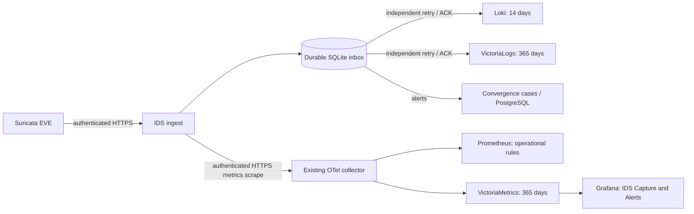

# IDS retention and metrics in the Victoria stack

The home deployment enabled this integration on **25 October 2026**. It extends
[passive IDS ingestion](convergence-ids.md) and
[three-switch capture](convergence-network-coverage.md). Capture remains passive,
and automatic IDS investigations remain disabled during tuning.

## Data paths



Retention periods are the deployed configuration, not a capacity guarantee.
Monitor disk growth and provide adequate persistent storage before accumulating
months of traffic. No packet payload capture or TLS interception is enabled by
this integration. The archived records are Suricata's existing structured EVE
observations.

| Data | Storage / semantics |
|---|---|
| Alerts, flow summaries, DNS, TLS metadata, engine stats | Both Loki and VictoriaLogs |
| Cases, findings, feedback | Existing Convergence PostgreSQL and learning pipeline |
| Packet/drop/decoder counters, rules, capture source health, queues, alert rates | OTel scrape every 30 seconds; exported to Prometheus and VictoriaMetrics |
| Local EVE inbox | Delivered metadata retained one day; delivered alerts 30 days; undelivered and unscheduled backfill rows protected |

VictoriaLogs records have bounded stream dimensions: `job=ids-eve`, `site`,
`sensor`, `event_type`. Endpoint addresses, VLANs, signature IDs and priorities
are searchable fields, not stream dimensions. `eve` contains the complete
canonical original JSON. `event_id` is the stable inbox identity. `_time` is the
original observation time, including historical replay; it is not replay time.

## Enable on an existing installation

1. Confirm VictoriaLogs and VictoriaMetrics are running with persistent volumes
   and sufficient disk. In this deployment they listen locally on 9428 and 8428.
2. In the **private** `deploy/convergence/secrets/ids/config.json`, add:

   ```json
   "victorialogs_url": "http://127.0.0.1:9428"
   ```

   Keep `loki_url` and the receiver configuration. The archive destination is
   optional for minimal installations. Endpoint URLs may include a reverse-proxy
   path prefix; HTTPS uses the host's normal certificate trust store.
3. In the private `deploy/convergence/secrets/ids/api.env`, retain the existing
   status URL/token and add `IDS_METRICS_TARGET=192.168.3.252:8445`, replacing the
   address for your deployment. It must match the ingest certificate's SAN and
   be reachable from the collector container. Fresh `prepare-ingest.py` output
   already includes this setting. Do not use the sensor's write token.
4. Restart the ingest service to apply its additive database migration and
   enable archive delivery:

   ```bash
   sudo systemctl restart netclaw-ids-ingest.service
   ```

   Sensor capture continues independently; the shipper buffers/retries while
   ingest restarts. Initial index creation may take longer on a large inbox.
5. Validate and enable the optional telemetry overlay:

   ```bash
   docker compose \
     --env-file deploy/convergence/.env \
     --env-file deploy/convergence/secrets/ids/api.env \
     -f deploy/convergence/docker-compose.yml \
     -f deploy/convergence/docker-compose.full.yml \
     -f deploy/convergence/ids/docker-compose.api.yml \
     -f deploy/convergence/ids/docker-compose.telemetry.yml \
     run --rm --no-deps otel-collector validate \
       --config=/etc/otel/config.yaml --config=/etc/otel/ids.yaml

   docker compose \
     --env-file deploy/convergence/.env \
     --env-file deploy/convergence/secrets/ids/api.env \
     -f deploy/convergence/docker-compose.yml \
     -f deploy/convergence/docker-compose.full.yml \
     -f deploy/convergence/ids/docker-compose.api.yml \
     -f deploy/convergence/ids/docker-compose.telemetry.yml \
     up -d --no-deps otel-collector

   docker exec netclaw-convergence-prometheus-1 \
     promtool check rules /etc/prometheus/alerts/ids.rules.yml
   docker kill --signal=HUP netclaw-convergence-prometheus-1
   ```

   Retain both IDS overlays and both environment files in future Compose
   operations. The collector gets only the read-only status token and public CA.
   `/metrics` requires that token; TLS certificate verification stays enabled.
   Existing device syslog and SNMP pipelines remain in the base OTel config.

The metric overlay is opt-in, so a minimal deployment or the existing K3s
manifests do not acquire an unavailable IDS dependency. For a later K3s move,
mount `otel-ids.yaml` as a second collector config and the CA as a read-only
volume, inject the two IDS environment values from a Kubernetes Secret, and
preserve reachability to the HTTPS ingest address. Do not place tokens in a
ConfigMap. No K3s migration was performed for this change.

## Backfill, failures and counters

On first enable, the service records a high-water mark for the retained inbox.
It schedules old rows in batches of at most 512, using no more than half the
queue capacity for backfill. Existing queued work drains before more history is
scheduled, keeping current observations moving. The cursor and each destination's ACK survive
restarts. Live intake continues. Neither unscheduled historical rows nor queued
rows are eligible for local pruning before archive delivery completes.

The three delivery workers retry independently. A VictoriaLogs outage leaves
Loki and case delivery operational until the bounded inbox fills; then sensor
backpressure preserves evidence on the sensor. Do not disable archive delivery
to hide an outage: doing so removes the archive's pruning/backpressure protection.

Archive delivery uses VictoriaLogs' Elasticsearch-compatible bulk endpoint and
requires a successful response for every record before marking a batch done.
An ambiguous response or a crash after remote acceptance can cause duplicates.
Use `event_id` for query-time deduplication when exact counts matter. This is
at-least-once delivery, not an exactly-once storage claim.

Backfill covers **only evidence still present in the local inbox**. Data already
pruned before enabling the integration is not recovered automatically from Loki.
Historical EVE stats are archived as logs; time-series history begins when the
collector starts scraping. New ingestion counters persist across restarts and
exclude duplicate intake and archive backfill. Suricata packet/drop/decoder
counters reset when the engine restarts; use `rate()` or `increase()` for trends.
Decoder categories can overlap and are not a count of distinct malicious packets.

## Review and acceptance

Open **Grafana → Convergence → IDS Capture and Alerts** (UID `convergence-ids`),
using the existing **VictoriaMetrics - Long Term** data source. On this host:
`http://192.168.3.252:3300/d/convergence-ids`.

All twelve panels query VictoriaMetrics: packet rates, loss fraction, decoder
categories, alert priority rates, mirror visibility, queue sizes, event rates,
statistics freshness, VLAN observation ages, sensor free space, rules and oldest
pending event age. A silent VLAN is not automatically a failed mirror.

Useful verification queries:

```bash
curl -fsSG http://127.0.0.1:9428/select/logsql/query \
  --data-urlencode 'query=job:ids-eve site:home | stats by (event_type) count()'
curl -fsSG http://127.0.0.1:8428/api/v1/query \
  --data-urlencode 'query=up{job="netclaw-ids"}'
curl -fsSG http://127.0.0.1:8428/api/v1/query \
  --data-urlencode 'query=netclaw_ids_delivery_pending_events'
curl -fsSG http://127.0.0.1:8428/api/v1/query \
  --data-urlencode 'query=netclaw_ids_archive_backfill_active'
```

Require an actual recent EVE event in VictoriaLogs, not only HTTP health. Compare
its `event_id`, original timestamp, sensor/site and `eve` JSON with the inbox.
Check recent time-series samples in **both** Prometheus and VictoriaMetrics.
Backfill is finished only when the active gauge is zero **and** the archive queue
has drained. Short-lived small queue sizes during ongoing intake are normal.

`ids.rules.yml` adds seven health rules: stale sensor, stale capture statistics,
missing mirror source, delivery backlog, sustained capture loss, stalled delivery
and failed metrics scrape. All have `investigate=false`. Historical backlog age
is ignored while backfill is scheduling, but a stalled destination is still
alertable. Existing collector-wide health rules cover loss of the collector.
These rules do not suppress Suricata detections or enable autonomous remediation.

Tests: run `.venv/bin/python -m unittest discover -s services/ids-ingest -q`.
The suite exercises per-destination failures, retained evidence across pruning,
bounded/restartable backfill, authentication, replay-safe counters, engine
counter resets and original evidence preservation. Rule behavior tests are in
`deploy/convergence/ids/tests-alerts.yml`; run `promtool test rules tests-alerts.yml`
from that directory. They check that historical replay cannot hide a Loki outage
or a stalled archive destination.

## Recorded deployment checks — 25 October 2026

- Initial retained-inbox replay completed and all three destination queues drained.
  VictoriaLogs returned **2,330,847** IDS records across alerts, flows, DNS, TLS
  and stats at the acceptance check (includes ongoing intake; not a deduplicated
  storage-count guarantee).
- An archived alert matched the inbox's stable ID, site, sensor, original
  observation timestamp and complete canonical EVE evidence.
- Prometheus and VictoriaMetrics each exposed **47 IDS metric series**; all
  three mirror sources were active. Unauthenticated `/metrics` returned 401.
- Grafana provisioned the twelve-panel board, and every panel query returned
  data from VictoriaMetrics. Recreating Grafana refreshed an existing stale
  provisioning bind mount.
- All seven IDS health rules were healthy/inactive. The 19 ingestion tests and
  two Prometheus rule scenarios passed; the installed OTel 0.104.0 binary
  validated the merged config.
- Unused Docker build and pip download caches were removed before adding the
  archive. The host had **10.5 GiB free** at completion. Additional persistent
  capacity or the planned K3s migration is still needed for sustained long-term
  retention; a 365-day setting does not reserve that storage.

## Rollback

Keep the database and volumes. Stop/reconfigure the collector with the original
base config to remove the IDS metrics receiver. Remove `victorialogs_url` and
restart ingest only if archive delivery is intentionally being retired; resume
an interrupted archive by retaining that setting and fixing its endpoint.
The schema migration is additive, so the earlier ingestion code can read the
same database. Rolling back stops future archival and can allow undelivered
archive evidence to be pruned under the older retention policy. Export or retain
the inbox first if that history must be preserved.

References: [VictoriaLogs bulk ingestion](https://docs.victoriametrics.com/victorialogs/data-ingestion/#elasticsearch-bulk-api)
and [OTel Prometheus receiver](https://github.com/open-telemetry/opentelemetry-collector-contrib/tree/v0.104.0/receiver/prometheusreceiver).
