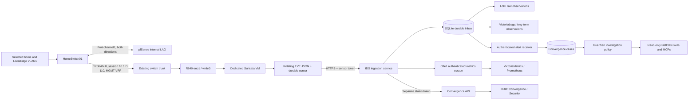

# Passive IDS with Convergence: installation and operations

This runbook builds a Suricata sensor VM, mirrors selected traffic to it with
ERSPAN, and delivers authenticated EVE observations into NetClaw Convergence.
It includes the deployment used in the home/LocalEdge network on 24 October 2026.
The sensor is passive: it cannot block packets or change firewall policy.

The live deployment now extends this initial firewall capture with
[three-switch endpoint capture and encrypted-traffic visibility](convergence-network-coverage.md).
Follow this guide for the base installation, then that guide for the expansion.
The firewall-only topology and commissioning results below describe the initial
stage, not the complete current capture scope.

For current long-term event retention, sensor metrics and replay behavior, follow
[IDS integration with the Victoria stack](convergence-ids-victoria.md).

## Architecture and coverage



A VLAN-aware trunk carries traffic forwarded to that port. It does not give a
sensor VM every conversation in every VLAN. ERSPAN supplies deliberate copies
of packets that traverse the configured source. The sensor decodes the Type II
ERSPAN header directly, preserving the original VLAN identifier.

The first source is the **entire firewall-facing port-channel, both directions**.
This sees traffic crossing the firewall before outbound NAT, including routed
traffic between the selected VLANs. It does not cover same-VLAN conversations
that stay on a switch, within one access point, or inside a hypervisor. Seeing a
VLAN in the HUD proves recent observations from that VLAN, not complete coverage
of every host or flow. A quiet VLAN remains **unverified**.

WAN mirroring is a separate future source. It can add blocked inbound probes and
firewall-originated traffic, but loses internal source identity after NAT and
duplicates some internal observations. HTTPS payload remains encrypted; DNS,
TLS and flow metadata can support investigation but do not prove exfiltration.

## VLANs in the Diary and Triage

The **Observed VLAN** column shows VLAN IDs reported by Suricata for each IDS
case. Expand **Capture context** for the sensor ID and the original ordered tag
array. Repeated tags such as `[100,100]` appear as one `100` badge in the column;
the details retain both tags. Multiple tags describe the observation, not a
route between the source and destination. Tag `0` is labeled as a priority tag,
not VLAN membership.

**Not recorded** means the alert has no VLAN tags. This can happen with untagged
traffic or inner tunnel events, including K3s VXLAN pod traffic. The HUD does
not assign VLAN 13 from a `10.42.x.x` pod address or from the sensor's management
network. **Unavailable** means the capture evidence is missing or invalid.
Non-IDS cases have a dash. VLAN names and endpoint network membership are not
inferred from an address or a VLAN number.

New IDS cases carry a versioned JSON `annotations.capture_context` containing
`version: 1` and `vlan_tags`. The sensor ID comes from authenticated ingestion's
`labels.sensor_id`. The events API adds normalized `capture_context` to diary,
escalated, and individual case reads: `sensor_id`, `vlan_tags`, and `status`
(`recorded`, `not_recorded`, or `unavailable`). For older cases, it reads the
complete EVE JSON already stored after the known description prefix. Truncated
or malformed descriptions remain unavailable. This is a read projection:
original evidence, case fingerprints, and investigation policy are unchanged;
no database backfill is needed.

Deploy the IDS ingestion code, rebuild `convergence-api` with the deployment's
existing Compose overlays, then build and restart the HUD. Check an existing
tagged case and a case with no tags through `/api/events?site=<site>` and the
Diary; check the raw evidence through `/api/events/<id>?site=<site>` if needed.
Raw EVE VLAN fields remain available in Loki and VictoriaLogs.

## Deployed example

| Component | Value |
|---|---|
| Hypervisor / template | `r640-pve` / Ubuntu 24.04 cloud-init template `8000` |
| Sensor VM | `113`, `netclaw-ids-01`; 4 vCPU, 8 GiB RAM, 80 GiB disk on `vm_disk` |
| Sensor address | `192.168.3.200/24`, gateway/DNS `192.168.3.1`; reserved in Nautobot |
| NIC | VirtIO on `vmbr0`, VLAN tag 3; guest MTU 9000 |
| Mirror source | HomeSwitch01 `Port-channel1`, both directions |
| ERSPAN transport | `192.168.3.2` → `192.168.3.200`, VRF `MGMT`, ID `110`, session `10` |
| Ingest service | NetClaw host `192.168.3.252:8445`, HTTPS |
| Sensor identity / site | `home-ids-01` / `home` |
| Engine | Suricata 8.0.7, image pinned by digest in `image.env.example` |
| Alert receiver / Convergence API | Existing services on ports `8099` / `3080` |
| Raw log storage | Loki plus VictoriaLogs, job `ids-eve` (Victoria integration added 25 October) |
| Automation | Cases enabled; automatic IDS investigations disabled during tuning |

| VLAN | Network | Purpose |
|---|---|---|
| 2 | `192.168.2.0/24` | Wi-Fi |
| 3 | `192.168.3.0/24` | Device management |
| 13 | `192.168.13.0/24` | K3s cluster / DNS / infrastructure |
| 100 | `192.168.100.0/24` | Home LAN |
| 101 | `192.168.101.0/24` | Personal-device / kids' laptops |
| 102 | `192.168.102.0/24` | IoT |
| 103 | `192.168.103.0/24` | Personal computer |
| 104 | `192.168.104.0/24` | LocalEdge hosting |
| 300 | `10.30.0.0/24` | LocalEdge backend |
| 301 | `10.30.1.0/24` | LocalEdge customers |

HOME_NET contains those IPv4 networks plus IPv6 ULA/link-local ranges. No routed
global IPv6 prefix was found on these interfaces during setup. Add actual global
IPv6 prefixes when deployed; do not assume IPv4 configuration covers them.
EXTERNAL_NET is `any` so internal peers are not automatically excluded from
signatures using that variable. The rule set still requires local tuning.

## 1. Verify the capture and management paths

Read the live configuration before allocating resources:

```text
show version
show capability feature monitor erspan-source
show monitor session all
show etherchannel summary
show interfaces trunk
show ip interface brief
show ip route vrf MGMT 192.168.3.0
```

Confirm an unused mirror session, a source carrying all requested VLANs, the
correct routing table, and enough bandwidth for copies plus normal traffic.
**IP routing must be enabled on the ERSPAN source.** The mere existence of a
management VRF routing table is insufficient: `show ip route vrf MGMT` reported
`Extended Host Mode is enabled` before this deployment. Check raw output and
`show running-config all`, since a structured parser can omit that warning.
On HomeSwitch01 we enabled `ip routing` after verifying VLAN 3 was the only
active SVI and that its existing management default route remained valid.
No SVI or route for the monitored user VLANs was added.
Use the whole port-channel; choosing one LAG member can omit one flow direction.
Do not convert the R640's existing production uplink into a local SPAN destination.

Reserve an unused sensor address in IPAM. Check DHCP pools/reservations, leases,
Proxmox allocations and ARP as well as ping. A failed ping alone proves nothing.
In this deployment `.200` is outside the DHCP range `.20`–`.29` and is recorded
in Nautobot. The switch has a management VRF: a lookup in the global table can
misleadingly report no route.

The transport path must carry the original packet **plus ERSPAN/GRE/IP overhead**.
This deployment uses MTU 9000 on the sensor, a 9198-byte switch system MTU, and
the existing 9500-byte Proxmox bridge/uplink. Verify the intervening ports and
test a full-size original packet. Setting the ERSPAN truncation MTU to 1500
would discard part of some original frames. Do not raise shared network MTUs
without checking the complete path.

## 2. Provision the dedicated sensor VM

The controller needs the repository Python environment with `requests` and
`python-dotenv`, and a Proxmox API token permitted to clone/configure/start VMs.
Set these environment variables from your private credential store:

```text
PROXMOX_HOST=https://your-proxmox-endpoint
PROXMOX_PORT=8006
PROXMOX_USER=your-user@pve
PROXMOX_TOKEN_NAME=your-token-name
PROXMOX_TOKEN_VALUE=<secret>
PROXMOX_CA_FILE=/path/to/proxmox-ca.crt
```

Keep the endpoint's actual port: a reverse proxy may use 443. Prefer CA
verification. `PROXMOX_VERIFY_SSL=false` is an explicit compatibility option for
an existing deployment with an untrusted certificate; it does not authenticate
the server. The current deployment inherited that Proxmox API posture. Sensor
telemetry itself uses a verified private CA.

From the repository root, run the preflight first:

```bash
.venv/bin/python deploy/convergence/ids/provision-proxmox.py \
  --node r640-pve --template 8000 --vmid 113 --storage vm_disk \
  --vlan 3 --address 192.168.3.200/24 --gateway 192.168.3.1 \
  --dns 192.168.3.1 --ssh-key ~/.ssh/id_ed25519.pub --reset-cloud-init
```

Adapt IDs, addresses and storage before using this elsewhere. Add `--apply` to
create and start the VM. Existing VM IDs are rejected. The script makes a full
clone, removes inherited passwords, resets custom cloud-init when explicitly
requested, removes the template's NIC rate limit, and sets the new SSH key and
address before first boot. Failed provisioning leaves the VM for inspection;
do not blindly delete it and retry.

Verify the new SSH host key through the Proxmox console or guest agent. This
template did not have a running guest agent on first boot; initial SSH trust was
established on the new address after checking its MAC against Proxmox. The sensor
installer subsequently enables the guest agent. Never disable host-key checking
for an already known host to make a changed key disappear.

## 3. Prepare ingestion credentials and TLS

The existing alert receiver must already have its authentication token and
Convergence case integration configured. On the NetClaw controller:

```bash
.venv/bin/python deploy/convergence/ids/prepare-ingest.py \
  --output deploy/convergence/secrets/ids \
  --receiver-env services/alert-receiver/.env \
  --server-ip 192.168.3.252 --sensor-id home-ids-01 --site home \
  --vlans 2,3,13,100,101,102,103,104,300,301
sudo install -d -o ubuntu -g ubuntu -m 700 /var/lib/netclaw-ids-ingest
sudo install -m 644 services/ids-ingest/netclaw-ids-ingest.service.example \
  /etc/systemd/system/netclaw-ids-ingest.service
sudo systemctl daemon-reload
sudo systemctl enable --now netclaw-ids-ingest
curl --cacert deploy/convergence/secrets/ids/ca.crt \
  https://192.168.3.252:8445/healthz
```

Adjust `User`, `WorkingDirectory`, Python path and certificate/config paths in
the systemd unit when the account or checkout differs. Install dependencies from
`services/ids-ingest/requirements.txt` into that environment when needed. Run
**one ingest process** per SQLite database; do not start multiple Uvicorn workers.

The preparation script refuses to overwrite credentials. The generated directory
is gitignored and mode 0700. It contains:

* `config.json`: allowed sensor identity/site, token hashes, receiver credential,
  state location and automation setting.
* `sensor-token`: write credential for this sensor only.
* `api.env`: separate read-only status credential for the Convergence API.
* `ca.crt`: public trust certificate, copied to sensor and Convergence API.
* `ca.key`: private signing key; retain only in protected controller backup.
* `server.crt` / `server.key`: ingest server certificate and key.

Server certificates expire after one year; the private CA after ten years.
Renew with the same CA and IP/DNS SANs before expiry, then restart ingestion.
Rotate a sensor token by replacing its configured hash and token file together,
then restart ingestion and the shipper. Backpressure retains pending data during
this interruption. No token or private key belongs in Git or a runbook.

## 4. Install the sensor

Copy the files in `deploy/convergence/ids/` to `/opt/netclaw-ids/` on the **new
sensor VM**. Copy `image.env.example` to `image.env` and `sensor.env.example` to
`sensor.env`; set the real interface, switch/sensor/ingest addresses and HOME_NET.
The current image digest is for **amd64**, not ARM64. Use a verified ARM64 digest
if deploying on that architecture.

Transfer only `ca.crt` and `sensor-token` from the controller's private IDS
directory. Protect `sensor.env`, `sensor-token` and the directory with modes
0600/0700. Then:

```bash
sudo bash /opt/netclaw-ids/install-sensor.sh
sudo systemctl status netclaw-ids-capture netclaw-ids-shipper --no-pager
sudo tail -20 /opt/netclaw-ids/logs/suricata.log
```

The installer installs Docker, the guest agent and capture utilities; preserves
the image's upstream Suricata defaults; applies the capture filter and HOME_NET;
downloads Emerging Threats Open rules; runs `suricata -T`; and starts capture,
the shipper and a daily update timer. It stops if the sensor container already
exists, to avoid replacing a running deployment accidentally.

Capture accepts GRE only from the configured switch to the configured sensor.
Type II decoding preserves VLAN attribution. One receive thread and four
detection workers use `autofp` on this VM. No packet payload or full PCAP archive
is enabled. EVE includes alerts, statistics, flows, DNS and TLS metadata, which
still contain sensitive network information and require protected storage.

The installer sets a persistent guest MTU of 9000 and disables GRO/LRO/TSO/GSO
when capture starts. Changing the capture interface requires reviewing the
netplan and systemd configuration as well as the Suricata configuration.
It also drops GRE from the source switch at the sensor's local INPUT hook.
AF_PACKET captures those frames before that hook; the rule prevents the normal
IP stack from returning ICMP protocol-unreachable for the mirrored traffic.
It does not drop traffic being forwarded through the home firewall.

## 5. Stage and enable the switch mirror

Back up running and startup configuration privately. For this Catalyst 3850
running IOS XE 16.12.5b, configure:

```text
ip routing
monitor session 10 type erspan-source
 shutdown
 description NetClaw_IDS_firewall
 source interface Port-channel1 both
 filter vlan 2 , 3 , 13 , 100 - 104 , 300 - 301
 destination
  erspan-id 110
  ip address 192.168.3.200
  origin ip address 192.168.3.2
  vrf MGMT
  mtu 9000
 exit
```

Give the mirror destination a stable unicast forwarding path. In this deployment
the sensor's MAC is `bc24.11ef.9e87`:

```text
! HomeSwitch01: path to the switch hosting the R640
mac address-table static bc24.11ef.9e87 vlan 3 interface Port-channel3
! HomeSwitch02: R640 eno1 uplink
mac address-table static bc24.11ef.9e87 vlan 3 interface TenGigabitEthernet1/1/1
```

Use **your new VM's MAC and verified physical paths**, never these values blindly.
The sensor mostly sends telemetry to a VM on the same host, so that traffic does
not refresh upstream MAC learning. Static entries prevent unknown-unicast flooding
of copies back toward a monitored source. They also pin the capture VM to this
host: update both entries before migrating or rebuilding it with a different MAC.
Check `show mac address-table address bc24.11ef.9e87` on both switches.

Commissioning exposed recursive ERSPAN copies and a feed that stopped shortly
after activation. Correcting forwarding and enabling the required IP routing
produced a sustained stream. Do not accept a single initial packet burst as proof
of a working installation. An IPv4 FSPAN ACL cannot be combined with this VLAN
filter on this IOS release; the attempted workaround was removed.

On this software, the VLAN filter requires spaces around commas/ranges in the
configuration input. Type II is the default; do not enable Type III with this
sensor configuration. Validate the staged session using `show monitor session 10`.
When the sensor is ready:

```text
monitor session 10 type erspan-source
 no shutdown
```

After acceptance checks, save the running configuration to startup configuration.
No additional VLANs need to be allowed on the VM trunk just to transport their
ERSPAN copies: the outer transport uses VLAN 3. Do not remove existing allowed
VLANs or reuse the backend NIC as a mirror destination.

## 6. Connect the HUD

Build the updated Convergence API with the optional IDS overlay:

```bash
docker compose \
  --env-file deploy/convergence/.env \
  --env-file deploy/convergence/secrets/ids/api.env \
  -f deploy/convergence/docker-compose.yml \
  -f deploy/convergence/docker-compose.full.yml \
  -f deploy/convergence/ids/docker-compose.api.yml \
  up -d --no-deps --build convergence-api
cd ui/netclaw-visual
npm run build
systemctl --user restart netclaw-hud-ui
```

If using the minimal stack, omit the full-stack Compose file and supply your
actual Loki address in the ingest configuration. Keep the IDS overlay and both
environment files in subsequent Compose commands, or the API loses its IDS
connection. The overlay mounts only the public CA and sets `NODE_EXTRA_CA_CERTS`.

Open **Convergence → Security**. Firewall log health and IDS sensor health are
independent. An unavailable firewall log store must not hide live IDS status.
Sensor heartbeat alone cannot make the sensor active: recent capture statistics,
packet activity, available rules and recent rule-update checks are required.
Per-VLAN observations use a 15-minute window; silence is reported as unverified.

## 7. Acceptance tests

Do not declare success from a running container alone:

1. `show monitor session 10` reports an enabled ERSPAN session with the expected
   source, filter, destination, VRF and MTU. Verify both LAG members are bundled.
2. On the sensor, `sudo timeout 10 tcpdump -ni eth0 -c 10 'ip proto 47'` sees the
   expected source and destination. Keep packet content out of shared logs.
3. Suricata's log reports nonzero loaded rules and no failed rules. EVE `stats`
   counters increase; watch kernel drops, decoder failures and stream gaps.
4. Send a harmless ICMP echo containing `NETCLAW-IDS-CANARY` **through the monitored
   firewall path**. It should match local SID `9000001`. A ping between two guests
   on the same host/VLAN may never reach that path and is not a valid test.
   For example, from the NetClaw host:

   ```bash
   sudo python3 deploy/convergence/ids/send-canary.py \
     --destination 192.168.3.1 --payload-size 1472
   ```

   This sends one 1500-byte IPv4 echo request to the firewall itself. Use an owned
   host beyond the firewall to test both routed legs as well.
5. Confirm the canary EVE record in Loki, a `SuricataCanary` Convergence case, and
   no automatic model investigation. Repeat/replay the same EVE record: it must
   not create another case. Use a fresh five-minute window for a new canary case.
6. Generate a normal, routed flow from each VLAN. Verify the original VLAN ID
   appears in EVE and in the HUD. Do not mark idle VLANs verified without evidence.
7. Test a 1500-byte original IPv4 packet through the monitored path; check the
   sensor receives and decodes it intact. Use `ping -M do -s 1472` where supported.
8. Briefly restart the shipper/receiver and verify catch-up. Pending records must
   survive, authenticated ingestion must reject a bad token, and counters must
   not falsely report active coverage after capture stops.
9. Recheck normal host connectivity, switch port errors, capture drops, sensor
   CPU/RAM, free disk and ingest backlog under ordinary load. A short acceptance
   run is not a sustained line-rate performance certification.

The canary signature is included in `local.rules` and always maps to an
observe-only informational case. Suricata priorities 1–2 initially create warning
cases; priorities 3 and higher create informational cases. The original numeric
priority is retained as `suricata_severity` and in the raw alert evidence. Review
alert quality and severity mapping before enabling escalation.

### Recorded commissioning results — 24 October 2026

After correcting ERSPAN forwarding, the sensor captured more than 2.3 million
packets with zero reported kernel drops during the initial observation period.
After a full VM reboot, capture and shipping started automatically, guest MTU
remained 9000, and the API again reported an active sensor with all ten selected
VLANs observed. A subsequent sample showed 506,685 packets, zero kernel drops and
zero pending deliveries. These counters reset when the engine restarts.

The following checks passed:

* 53,269 external signatures plus the local canary loaded with no failed rules.
* A 1500-byte IPv4 canary produced a VLAN-attributed EVE observation, a Loki
  record and Convergence case `8bbb333a-72f6-419e-a022-998235bfb5e5`.
* Replaying that exact observation inserted zero new records. Unauthenticated
  ingestion returned 401, and an attempted case PATCH could not replace original
  source evidence.
* An eight-second ingestion outage made IDS status unavailable; the sensor
  retained its spool and resumed delivery when ingestion returned.
* Both switch configurations were saved to startup configuration. Sensor capture,
  shipping and the daily rule-update timer were enabled across the reboot.
* Ingest, receiver, API and HUD regression checks passed, including independent
  log/case delivery failures, stale sensors, quiet VLANs and escaped sensor text.

The capture does report some unknown-EtherType/VLAN decoder events (433 decoder
errors in the 506,685-packet sample). These need classification and tuning;
zero kernel drops does not mean every packet was decoded. Recursive ERSPAN
decoder alerts from initial commissioning remain in history; no new recursive
alerts were observed after the forwarding fix. Alert totals include commissioning
noise and informational signatures and must not be read as confirmed intrusions.

This validates the deployed firewall path under observed load. Same-VLAN coverage,
WAN mirroring, global IPv6 validation and sustained peak-load testing remain
separate work. Automatic IDS investigations remain disabled during tuning.
Engine startup took roughly 40 seconds here; reboots and changed-rule restarts
create a detection gap. K3s migration has not been performed.

## Delivery, retention and failure behavior

The sensor rotates EVE hourly and records file identity/offset in SQLite. It
advances the cursor only after the receiver acknowledges the entire batch.
After a restart, replay is safe: the receiver deduplicates canonical EVE records
by sensor identity and content. Invalid or oversized records stop the shipper
with a logged error; they are not silently discarded.

The receiver commits observations before acknowledgement. Loki, VictoriaLogs and
case delivery have independent durable checkpoints and retries. Cases correlate
the same sensor, signature, source/destination, VLAN and five-minute window.
The existing alert receiver then persists cases and applies Guardian policy.
Model or MCP availability cannot prevent recording an IDS observation.
Cases retain `source_evidence` separately from editable investigation notes;
manual follow-up includes the original observation as untrusted evidence.

The receiver has a 250,000-pending-record limit and a 512 MiB free-disk reserve.
When full it returns 503, and the sensor retains its files. Metadata rows already
delivered are retained locally for one day; alert rows for 30 days. Undelivered
rows never expire automatically. Log retention follows the configured Loki and
VictoriaLogs retention periods.
The optional Victoria integration protects undelivered archive rows and pending
historical replay from pruning; see its linked runbook. The sensor deletes only
fully acknowledged EVE files older than 48 hours. A long outage can exhaust sensor disk: monitor free space and
restore delivery or increase capacity before that happens.

These durability boundaries do **not** guarantee that every original network
packet was observed. A congested mirror path, switch copying limit, capture
drop, restart, or unmonitored source can still create a detection gap.

## Operations and recovery

```bash
# Sensor
sudo systemctl status netclaw-ids-capture netclaw-ids-shipper --no-pager
sudo journalctl -u netclaw-ids-shipper -n 40 --no-pager
sudo systemctl list-timers netclaw-ids-rules.timer
sudo cat /opt/netclaw-ids/rules-status.json
sudo df -h /opt/netclaw-ids

# Controller
sudo systemctl status netclaw-ids-ingest --no-pager
sudo journalctl -u netclaw-ids-ingest -n 40 --no-pager
```

Rule updates stage a candidate ruleset and run the deployed engine's validation
before promotion. Only a changed validated file restarts capture; this creates a
short detection gap. The previous ruleset remains in `rules/suricata.rules.previous`.
To recover a bad update, stop the timer, restore that file, run `suricata -T`,
restart capture, and investigate before reenabling the timer. An update failure
must not mark the rules fresh.

Back up private ingest configuration/CA keys, the SQLite database using SQLite's
backup API (or stop the service while copying DB/WAL files), the sensor's config
and cursor database, and the existing Convergence case database. Protect backups
as credentials and network telemetry. Use Proxmox backup for the sensor VM;
restoring its disk can replay EVE, which is expected and deduplicated.

For a sensor upgrade, retain the old image digest, test the new engine with the
existing config/rules, stop capture, replace only its named container using the
same volumes and capabilities from `install-sensor.sh`, and restart. Re-run the
canary and inspect capture statistics. Do not run the initial installer over a
live sensor.

To enable automatic investigations later, set the sensor's `auto_investigate`
to true in private ingest configuration and restart ingestion. Add an explicit
`SuricataIntrusion` rule to the existing investigation policy only after tuning;
existing concurrency, hourly and deduplication budgets still apply. Canary
events remain observe-only. This does not authorize automated containment.

## Rollback

Disable mirroring first:

```text
monitor session 10 type erspan-source
 shutdown
```

Save the switch configuration. Stop `netclaw-ids-capture` on the sensor; leave the
shipper/ingestion service running long enough to drain pending observations.
If abandoning this source permanently, remove only `monitor session 10`, then
remove the two sensor-specific static MAC entries and save. HomeSwitch01's
`ip routing` was enabled as an ERSPAN prerequisite; restoring `no ip routing`
is appropriate only if its Layer 3 configuration still matches the pre-deployment
baseline. Review any subsequent routing changes first. Existing firewall policy
and trunk membership were not changed by this deployment.

To remove the HUD integration, redeploy the API with its original Compose files
and environment, omitting the IDS overlay. Retain case history, private backups,
EVE spool and inbox until data is accounted for. Shut down VM 113 only after
verifying its identity; do not delete a VM or release its IP as an automatic
rollback step.

## K3s follow-up

This installation uses the existing Docker Convergence backend. The existing
K3s observability deployment still needs its separate migration/consolidation.
Keep the capture VM close to the mirrored network. Ingestion can move to K3s
with a single replica, durable volume, TLS endpoint and Secrets; migrate its
SQLite state and update sensor/API endpoints together. Do not point this feed
at the older K3s Guardian deployment without validating its receiver auth,
case schema and feature parity first.

## References

* [Cisco 3850 ERSPAN configuration](https://www.cisco.com/c/en/us/td/docs/switches/lan/catalyst3850/software/release/16-12/configuration_guide/nmgmt/b_1612_nmgmt_3850_cg/onfiguring_erspan.html)
* [Suricata EVE output](https://docs.suricata.io/en/suricata-8.0.7/output/eve/eve-json-output.html)
* [Suricata ERSPAN decoder](https://github.com/OISF/suricata/blob/suricata-8.0.7/src/decode-erspan.c)
* [Proxmox cloud-init](https://pve.proxmox.com/wiki/Cloud-Init_Support)

## Public-IP attribution

For country, ASN and network organization context on new IDS observations, see
[public-IP context setup](convergence-ip-context.md). This uses a local IPinfo
database and preserves the original event evidence.
