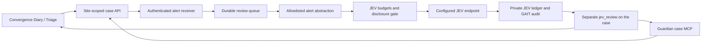

# JEV advisory reviews in Convergence

Convergence can ask JEV for a second opinion on a stored `SuricataIntrusion`
case. In **Convergence → Diary**, expand **JEV · advisory review** and choose
**Review with JEV**. The same action appears in Triage. Guardian can request it
through `convergence-case-mcp__case_jev_review` during an authorized investigation.

The review provides a suggested next read-only check and an evidence-strength
score on a 0–3 rubric. It evaluates an abstraction of one alert, without flow,
packet or endpoint corroboration. The score is a model judgment, **not an incident
probability**. Use the suggestion to collect evidence, then decide locally what
that evidence supports. JEV does not change severity or case status, suppress an
alert, block traffic, or launch a full investigation. Existing investigation
policy still controls automatic work; enabling reviews does not enable T2 IDS
investigations.

## Data flow and disclosure boundary



Only these fields form the outbound state:

| Field | Allowed values |
|---|---|
| Rule family | Protocol anomaly, decoder event, scan/reputation, malware, exploit, policy, other |
| Rule priority | Suricata 1–3, or unknown |
| Protocol | Known transport and application protocol enums, or unknown |
| Endpoint scopes | Private, public, non-public special, unknown |
| VLAN metadata | Recorded, not recorded, unavailable |
| Evidence limits | Fixed statements describing the limits of a single alert |

The questions use those enum values and fixed diagnostic choices. Addresses,
VLAN IDs, site and sensor names, raw signatures, payloads, timestamps, case IDs,
investigation notes and operator feedback are excluded from the provider payload.
The server derives the abstraction from the original stored evidence; caller
payloads cannot replace it. Incomplete or truncated original evidence is rejected.
The existing JEV disclosure gate runs before dispatch and remains authoritative.

`events.jev_review` holds the typed answers, assessment ID, model, cost, audit
status and exact abstract input. `source_evidence` remains unchanged. A review
alone does not queue learning; Guardian's subsequent evidence-based findings use
the existing case-update and learning path.

## Enable on a host deployment

1. Install and configure the existing [JEV integration](../../mcp-servers/jev-mcp/README.md).
   In the root `.env`, set `JEV_ENABLED=true`, `CONVERGENCE_JEV_ENABLED=true`,
   and your `TYPESAFE_API_KEY` (or `JEV_API_KEY` alias). Use your configured model,
   endpoint and JEV budget settings. Keep the file private; do not put the key in
   browser settings, the Convergence API container, or Guardian's prompt.
2. Keep `JEV_DATA_DIR` shared with the existing JEV integration so the daily cap
   applies across HUD/Border and Convergence. Its directory must have mode `0700`.
   Each case has a server-derived budget identity based on its site and UUID;
   caller-provided `JEV_TASK_ID` values cannot reset the case budget. Core settings
   in `JEV_DATA_DIR/settings.json` retain their existing precedence over env limits.
3. The receiver reads only JEV configuration from the root `.env`. To use another
   file, set `CONVERGENCE_JEV_ENV_FILE` in the receiver service environment. Explicit
   process variables override that file. The receiver Python runtime needs the
   repository's existing `httpx` and `python-dotenv` dependencies.
4. For the hardened systemd service, install the optional
   [JEV drop-in](../../scripts/systemd/netclaw-alert-receiver-jev.conf.example).
   Adapt its paths (including the tokenizer cache) and ensure both directories
   exist. It permits writes only to
   the JEV ledger and local GAIT repository in addition to existing receiver paths:

   ```bash
   sudo install -d /etc/systemd/system/netclaw-alert-receiver.service.d
   sudo install -m 644 scripts/systemd/netclaw-alert-receiver-jev.conf.example \
     /etc/systemd/system/netclaw-alert-receiver.service.d/jev.conf
   sudo systemctl daemon-reload
   ```

5. Rebuild/restart `convergence-api` using **all Compose overlays and env files
   used by your deployment**. API startup adds the nullable JSONB review column
   idempotently. Restart `netclaw-alert-receiver`, build `ui/netclaw-visual`, then
   restart its preview service. The existing HUD proxy already forwards the new
   route. The base Compose file includes the Linux `host.docker.internal`
   host-gateway mapping needed for receiver callbacks. API writes require an
   operator/admin token and remain site-scoped.
6. Apply the JEV paragraph from the repository's
   [Guardian instructions](../../deploy/convergence/config/guardian-instructions.md)
   to the member workspace `AGENTS.md`, preserving local instructions. Reload
   the member's MCP runtime or restart its service. The existing
   `convergence-case-mcp__*` permission covers the new tool; Guardian needs no
   general HTTP/shell access or provider credentials.

Use a current IDS case for verification. A successful request to
`POST /api/events/:id/jev-review?site=home` returns `202` with a durable job ID.
Read `GET /api/events/:id?site=home` for `jev_review`. Check `status: ok`, the
assessment ID, audit status, and unchanged original evidence/status/severity.
Repeating the POST returns the same completed review. The HUD polls for up to
30 seconds; **Check review** retrieves delayed work and can retry failed delivery.

## Budget, recovery and limitations

- Reviews are opt-in and requested per case, not for every collected packet or
  alert. One review worker is separate from ingestion and full investigations;
  review dispatches do not consume T2 hourly slots. Queue capacity is shared.
- Existing JEV daily and case spending limits apply before outbound requests.
  Unknown provider charges retain their reservation. A provider timeout is not
  interpreted as a successful assessment or proof of safety.
- The receiver commits dispatch intent and the exact request digest before the
  provider call. If interrupted, it recovers the shared JEV ledger result or marks
  the outcome unavailable. It never blindly repeats an uncertain provider call.
  Delivery failures retry the cached result, without a second evaluation.
- Review checkpoints are retained in receiver SQLite, including failed delivery
  checkpoints. Preserve that database and the JEV ledger when moving services.
  Completed case records also prevent duplicate requests. Do not delete those
  records to retry a charge with an unknown outcome.
- There is one review attempt per case. Disabled, unavailable and budget-limited
  outcomes remain visible; changing configuration does not automatically reevaluate
  old cases. Review a new case after repairing configuration. This initial version
  supports Suricata intrusion cases only, not arbitrary notes or a review of the
  complete Guardian investigation.
- Set `CONVERGENCE_JEV_ENABLED=false` to stop new evaluations. Cached results can
  still be delivered and read. Existing IDS ingestion and investigations continue.

If reviews fail, check receiver health/jobs, the case's review status, the root
JEV settings and service write permissions. `audit.gait.status: unavailable`
means the local JEV ledger was retained but GAIT recording failed. Check paths
and the receiver's GAIT Python runtime; do not rerun an evaluation just to repair
an audit entry.
