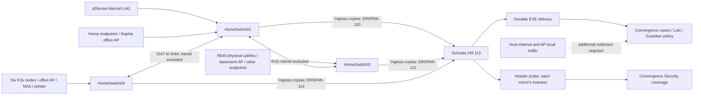

# Network-wide passive capture and encrypted traffic visibility

This extends the [initial IDS installation](convergence-ids.md) with endpoint
ingress capture on HomeSwitch01, HomeSwitch02 and HomeSwitch04. The machine-readable
[capture plan](../../deploy/convergence/ids/home-capture-plan.json) records the
selected ports, VLANs, ERSPAN identities and known gaps. It contains topology,
not credentials. Update it when devices move or switch ports change.

## What is covered

The selected VLANs remain **2, 3, 13, 100, 101, 102, 103, 104, 300 and 301**.
Other lab VLANs found on trunks are not silently added to this scope.



Mirroring ingress at the endpoint boundaries captures both sides of a
conversation when both endpoints' attachment points are included. Excluding
inter-switch links avoids copying the same packet again at every transit hop.
Firewall ingress is included for return traffic and routed traffic entering the
selected VLANs. A routed conversation can still produce observations on both
VLANs; these are distinct observation contexts, not proof of two attacks.

This design supersedes the original **Po1 both-directions** capture. Keeping that
old mirror as well would duplicate endpoint-to-firewall traffic. It also avoids
adding the ERSPAN transport uplinks as mirror sources.

| Switch | Origin / monitor session / ERSPAN ID | Endpoint ingress sources | Excluded transit |
|---|---|---|---|
| HomeSwitch01 | `192.168.3.2` / 10 / 110 | Gi1/0/1,3,7,11,16,17,18,20,41,45,46; Po1 | Po3 and Gi1/0/44 |
| HomeSwitch02 | `192.168.3.3` / 12 / 112 | Gi1/0/9–13,26,29,46; Te1/1/1–2 | Po3 |
| HomeSwitch04 | `192.168.3.5` / 14 / 114 | Gi1/0/3,5,11–12,35–40 | Gi1/0/47 |

All six home K3s nodes attach to HomeSwitch04 Gi1/0/35–40, in node order
server-1, server-2, server-3, worker-1, worker-2, worker-macmini-1. Their addresses
are `192.168.13.2`, `.3`, `.4`, `.10`, `.11` and `.12`. The observed CNI is Flannel
VXLAN with pod subnets within `10.42.0.0/16`.

UniFi inventory identified four online APs. The office AP attaches to
HomeSwitch04 Gi1/0/5; Sophie's office AP to HomeSwitch01 Gi1/0/17; basement laundry
AP to HomeSwitch02 Gi1/0/13. The master-bedroom AP's MAC was learned behind that
same basement uplink. The precise downstream/mesh forwarding arrangement still
needs verification. AP-local conversations are not claimed as captured.

## Preconditions and staging

1. Read the running configurations, CDP/LLDP neighbors, MAC tables, interface
   state, trunk allowed VLANs and LAG membership. Port descriptions can be stale:
   HomeSwitch01 Gi44 was labelled as a wall plate but CDP identified HomeSwitch04.
2. Save private before-change configurations. Check that the session numbers are
   unused or owned by this deployment. Do not overwrite another SPAN session.
3. Confirm only the intended management SVI is active before enabling `ip routing`
   for ERSPAN. On HomeSwitch02, this deployment enabled it with only Vlan3 active;
   the existing MGMT default route remains `192.168.3.1`. HomeSwitch01 and 04
   already had routing enabled. No monitored user-VLAN SVI was added.
4. Verify the entire mirror path can carry encapsulation overhead. HomeSwitch04
   initially used system MTU 1500; it was changed to 9198, matching the other two
   switches. The setting applied without a reload on the deployed IOS XE 16.12.
   The sensor remains 9000 and R640 bridge/uplink 9500. This is a global switch
   setting: check routed-interface MTUs and device-specific behavior elsewhere.
5. Check link capacity before adding copies. HomeSwitch04's uplink is 1 Gb/s and
   carries normal traffic and mirror copies. Its historical CRC/output-drop
   counters were nonzero before this change; compare deltas, not lifetime counts.

For a new source, use the existing site's verified management VRF and a unique
ERSPAN ID. Stage the session in shutdown state. Example for HomeSwitch04:

```text
mac address-table static bc24.11ef.9e87 vlan 3 interface GigabitEthernet1/0/47
monitor session 14 type erspan-source
 shutdown
 description NetClaw_IDS_endpoint_ingress
 source interface Gi1/0/3 rx
 source interface Gi1/0/5 rx
 source interface Gi1/0/11 - 12 rx
 source interface Gi1/0/35 - 40 rx
 filter vlan 2 , 3 , 13 , 100 - 104 , 300 - 301
 destination
  erspan-id 114
  mtu 9000
  ip address 192.168.3.200
  origin ip address 192.168.3.5
  vrf MGMT
```

Use the source table for the other switches. VLAN filtering limits trunk
sources; access-port selection must itself respect the VLAN scope. The static
sensor MAC entry on HomeSwitch01 remains via Po3 and on HomeSwitch02 via Te1/1/1.
All three entries pin the sensor's transport path: review them before moving
the VM or changing its MAC.

## Sensor and controller configuration

On the sensor, back up `sensor.env`, the active YAML and capture systemd unit.
Copy the updated Python helpers and `netclaw-ids-probe.service` from
`deploy/convergence/ids/`. Copy the `capture_sources` array from the reviewed plan
to `/opt/netclaw-ids/capture-sources.json`, mode 0600. For another deployment,
adapt `capture-sources.example.json` with the actual IPv4 origins and ERSPAN IDs.
Make `/opt/netclaw-ids` root-owned and mode 0700. The probe's restricted capability
set deliberately lacks permission to bypass another user's private directory.

Set this deployment's sensor environment:

```text
IDS_SWITCH_IP=192.168.3.2,192.168.3.3,192.168.3.5
```

Retain all existing HOME_NET entries and add `10.42.0.0/16` for the verified home
cluster pod networks. The renderer enables VXLAN decoding on both 4789 and
Flannel's 8472, and explicitly enables TLS JA3/JA4 fingerprints. This does not
decrypt TLS. Render a candidate before changing the active configuration:

```bash
cd /opt/netclaw-ids
source sensor.env
source image.env
python3 render-sensor.py --base config/upstream.yaml \
  --output config/coverage-candidate.yaml --interface "$IDS_INTERFACE" \
  --switch-ip "$IDS_SWITCH_IP" --sensor-ip "$IDS_SENSOR_IP" \
  --home-net "$IDS_HOME_NET"
docker run --rm --network none --entrypoint suricata \
  -v /opt/netclaw-ids/config:/etc/suricata:ro \
  -v /opt/netclaw-ids/rules:/var/lib/suricata/rules:ro \
  "$SURICATA_IMAGE" -T -c /etc/suricata/coverage-candidate.yaml
```

After validation, promote the candidate, install the updated capture/probe
units, run `systemctl daemon-reload`, enable/start `netclaw-ids-probe`, and restart
capture and shipping. Expect an engine startup gap. `capture-network.py` adds
destination-specific GRE INPUT rules for only the configured origins, allowing
AF_PACKET to capture without kernel ICMP reject replies.

In the controller's private ingest config, add the same `capture_sources` array
to the sensor record. Set `scope` and `coverage_gaps` to the verified deployment
boundaries from the plan; restart ingestion. Keep `auto_investigate: false`
during tuning. Rebuild the HUD using the initial runbook's instructions.

The header probe reads at most 128 bytes per packet, records only expected
origin/session IDs, timestamps, counts and VLAN IDs, and retains no packet
payload. It cannot prove Suricata processed every packet. Its per-source
liveness complements the engine's packet/drop/rule checks. A stale probe or a
missing configured source degrades sensor health even while another source
continues delivering observations. Counts reset with probe restart.

## Activate and validate

Enable the staged sessions with `no shutdown`. On HomeSwitch01, replace the old
Po1 both-direction source with the listed RX sources; do not leave both capture
strategies active. Inspect the actual running-config diff and `show monitor
session all`: a tool's success response alone does not prove IOS accepted every
line. Save each switch's running configuration only after validation.

Required checks:

* All three named capture points produce recent ERSPAN headers and the source
  IDs match the trusted plan. Unknown origins cannot claim a configured identity.
* A direct, same-VLAN ICMP canary between two K3s nodes produces SID 9000001 with
  the original VLAN and endpoint addresses in EVE, Loki and a Convergence case.
* A 1500-byte original IPv4 packet from HomeSwitch04 arrives intact; inspect
  fragmentation, decoder errors and switch port error deltas.
* A cross-node pod flow shows inner `10.42.*` addresses after VXLAN decoding.
  Seeing only outer UDP/8472 is insufficient proof of pod visibility.
* Existing firewall-path observations continue. No local mirror can establish
  coverage for all hosts solely from a VLAN's presence in one packet.
* Temporarily stop the header probe and confirm the HUD marks source liveness
  stale while engine capture continues, then restore it. Pending EVE remains
  durable through controller or shipper restarts.
* Observe capture drops, CPU/RAM, source uplink utilization and durable delivery
  backlog under representative load. Repeat with expected backup/replication
  peaks before declaring sustained throughput validated.

## Recorded validation — 24 October 2026

All three source sessions were enabled and their exact RX port lists verified
against the plan. HomeSwitch04 reported an applied MTU of 9198. Its uplink CRC
and output-drop counters did not increase between pre-change and verification
samples. This is a short observation, not a long-term link-health certification.

* Direct `192.168.13.2` → `192.168.13.3` canary: a 1500-byte reply returned;
  SID 9000001 retained VLAN 13 in EVE, reached Loki and created Convergence case
  `304234b3-fb18-4978-9e6f-bf3a7fc1cbec`.
* Original firewall-path canary: `192.168.3.252` → `192.168.3.1` still produced
  case `9d5b6c85-44ef-48f7-9b50-393ca0580e01` and an intact 1500-byte reply.
* Cross-node pod flows appeared with inner `10.42.*` source/destination addresses
  in both the durable inbox and Loki. The sample included HTTP/2 traffic.
  Inner VXLAN records do not always retain an outer VLAN field; do not fabricate
  VLAN attribution from its absence.
* Post-change same-subnet flow observations were present for VLANs 2, 3, 13,
  100 and 102. This is additional evidence beyond seeing a VLAN identifier in
  a control frame. Quiet or host-internal traffic on other VLANs remains unverified.
* Capture exceeded two million packets with zero reported kernel drops during
  the verification period. Delivery was caught up and all three mirror sources
  reported active. Some decoder errors remain; those are exposed independently.
* Stopping only the header probe caused source statuses to become stale and
  sensor health to degrade while Suricata kept capturing. Starting it restored
  all three source statuses automatically.
* The HUD API exposed the three source identities and TLS metadata counters.
  Fourteen ingest/probe/render tests, four API reliability tests, three HUD
  rendering tests and the HUD production build passed.

These tests do not certify sustained line-rate capacity or the remaining
host/AP-internal capture boundaries.

## Remaining capture boundaries

| Boundary | Next implementation | Acceptance evidence |
|---|---|---|
| VMs on the same R640 bridge | Host/virtual-bridge capture excluding sensor and mirrored GRE | Canary between co-resident VMs that never traverses eno1 |
| Pods on the same K3s node | Per-node capture or compatible network/runtime telemetry; validate ARM64 and amd64 | Same-node pod conversation plus workload identity |
| Local AP or mesh forwarding | Verify topology and AP capture capabilities; supplement with endpoint telemetry | Two clients whose packets remain inside that wireless path |
| New or moved endpoint | Update topology/port inventory and reviewed capture plan | Both flow directions and source liveness after the move |
| WAN-only probes | Separate WAN sensor/feed with clear NAT attribution | Known inbound test, correlated to firewall decision |

Each new feed needs an identity, authenticated delivery, explicit scope and
health checks. Do not merge an unverified host feed into an existing healthy
sensor's claim. Flow/runtime telemetry can add workload identity but is not
automatically equivalent to packet signature inspection.

## Encrypted traffic roadmap

**Available now:** passive TLS handshake metadata, visible server names,
JA3/JA4 fingerprints, flow endpoints and byte counts, plus DNS where observable.
The Security view reports recent TLS observations and metadata availability.
A fingerprint is evidence for correlation, not a malware verdict. TLS 1.3,
resumption, missed handshakes and encrypted client hello can limit visible
fields. Encrypted DNS also removes some passive DNS visibility.

**First payload-inspection candidate: services we operate.** Collect useful
request/security logs at their existing TLS termination point. For packet IDS
inspection, arrange an explicitly scoped plaintext mirror at that termination
point or a supported decryption-to-sensor integration. Keep backend encryption
where required; do not disable it globally to help a sensor. Sanitize credentials,
cookies and request bodies before central storage or LLM investigation.

**Managed-client pilot:** an explicit TLS inspection proxy can terminate and
re-establish selected connections when the client trusts its private CA. Begin
with a dedicated test client and owned test service. Define destination scope,
certificate validation, access/retention rules, exclusions and rollback before
expanding. Pinned applications and mTLS require special handling; bypass or
exclude unsupported applications rather than silently breaking their trust.
HTTP/3/QUIC must be tested explicitly; a TCP-only proxy is incomplete coverage.
Decrypted proxy logs and plaintext packet export are different integration paths.

**Targeted troubleshooting:** application-provided session keys can enable
decryption in compatible analysis tools for controlled captures. Keys are
sensitive and should not enter Convergence prompts or ordinary log storage.
Possession of a server certificate/private key alone does not unlock modern
forward-secret TLS sessions. Suricata's ordinary passive feed is not a universal
TLS decryption engine.

No interception CA, TLS proxy, client trust-store change or payload decryption
is deployed by this capture expansion. The next decryption milestone is a
small, documented pilot with an owned application/client, followed by a decision
based on coverage and operational cost.

## Rollback

Shut down sessions 12 and 14 first. Restore HomeSwitch01 session 10 to the
original Po1 both-direction source by removing the added RX source list and
adding `source interface Po1 both`. Leave the original filter, destination,
VRF, MTU and ID intact. Verify the firewall canary and save the configurations.

Restore the sensor's prior YAML, environment and capture unit; stop/disable the
probe if returning to the old deployment. Restore the private controller config
without the additional capture sources, then restart ingestion. Retain EVE,
cursor state and case history. Remove only owned unused mirror sessions/static
MAC entries after copies have stopped. Reverting HomeSwitch02 routing or
HomeSwitch04's MTU requires checking that no subsequent change depends on them;
neither is an automatic rollback action.

## Primary references

* [Cisco Catalyst 3850 ERSPAN](https://www.cisco.com/c/en/us/td/docs/switches/lan/catalyst3850/software/release/16-12/configuration_guide/nmgmt/b_1612_nmgmt_3850_cg/onfiguring_erspan.html)
* [Cisco system MTU](https://www.cisco.com/c/en/us/td/docs/switches/lan/catalyst3850/software/release/16-12/configuration_guide/int_hw/b_1612_int_and_hw_3850_cg/configuring_system_mtu.html)
* [K3s networking requirements](https://docs.k3s.io/installation/requirements)
* [Suricata TLS fingerprints](https://docs.suricata.io/en/suricata-8.0.0/rules/ja-keywords.html)
* [TLS inspection certificates and application compatibility](https://docs.mitmproxy.org/stable/concepts/certificates/)
* [Wireshark TLS decryption](https://wiki.wireshark.org/TLS)
