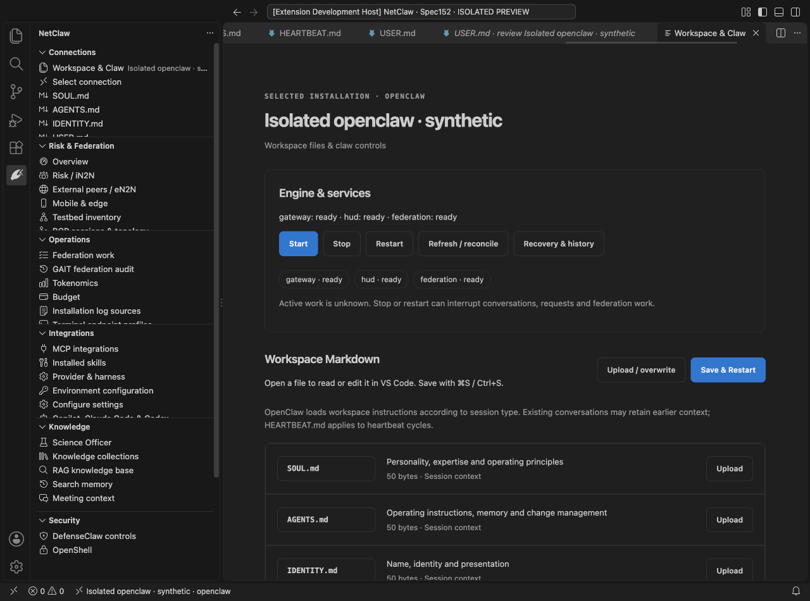

# Exact packaged candidate acceptance

Candidate **NetClaw 1.1.0**, built from source commit
`0f30b260915389339523a592792d32b507c9012c` on 2026-10-15.
The source tree was clean and committed before the repository's packaging script ran.
It ran TypeScript check/build and validated emitted runtime assets and license notices.

- VSIX: `netclaw-1.1.0.vsix`, **4,225,859 bytes**.
- SHA-256: `0f8ac4bd8bd9bd64c9198ea66ec501a81c1f8b17c02f736ab0e5dd613b28b75d`.
- Extension bundle SHA-256: `c262b80dbc146ca0aef6735c0cadb8393b6858aaf9c1bb498741bf7adfeb4a0f`.
- 36 archive entries, 34 extension payload files. Both workspace resources and all
  contributed commands are present; no test tree, `.env` or `node_modules` is included.
- **All 34 installed payload files match the VSIX**, allowing VS Code's own
  `package.json.__metadata` field. The activated path was the fresh profile's
  `extensions/netclaw.netclaw-1.1.0`, not the source development directory.

The exact installed artifact passed **35 native checks on VS Code 1.141.0 / macOS
arm64**. This includes each of the six files on both runtimes, exact upload bytes,
keyboard/Undo, cancellation, Save & Restart, real owned fixture Stop/Start and offline
recovery after an actual extension-host reload. Light/dark/high-contrast and 200% zoom
were exercised; the narrow content width was 350 pixels on this editor (350 scroll
width), with no overflow. Full machine-readable checks and widths are in
[mac-installed-results.json](mac-installed-results.json).

The private acceptance profile ends in `netclaw152-editor-mgECwa`; raw reports,
activation metadata and screenshots remain there locally. The final isolated editor
was left open. Synthetic engines/federation and the actual source HUD API were used;
no real provider/device/runtime was changed. This does not claim live WSL qualification.

The owner authorized this artifact's inclusion on the feature branch and a handoff to
inspect real workspace files in WSL. See [the continuation prompt](../WSL-HANDOFF.md).
No merge, normal editor installation, live deployment or Marketplace release occurred.
